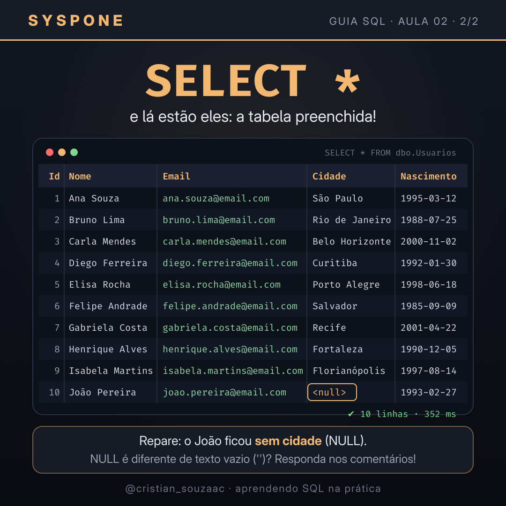

# 📘 GUIA SQL

Guia prático de SQL, feito aula por aula no **SQL Server** usando o **DataGrip**.
O tema dos exemplos é uma rede social no estilo Facebook: começamos pela tabela de usuários e vamos evoluindo.

> Projeto da **SYSPONE**, por Cristian Matias de Souza. Cada aula também vira um post no Instagram [@cristian_souzaac](https://www.instagram.com/cristian_souzaac/).

---

## 🗂️ Estrutura

| Arquivo | Tipo | O que ensina |
|---|---|---|
| [`01_CREATE.sql`](01_CREATE.sql) | DDL | `CREATE TABLE`, `ALTER TABLE` (adicionar, alterar e remover coluna) e `DROP TABLE` |
| [`02_insert_usuarios.sql`](02_insert_usuarios.sql) | DML | `INSERT INTO` com várias linhas de uma vez e conferência com `SELECT` |

Os arquivos são numerados na ordem em que devem ser executados.

## 🧱 Modelo atual

```text
dbo.Usuarios
├── UsuarioId       INT IDENTITY(1,1)  PK  (número automático)
├── Nome            NVARCHAR(100)      obrigatório
├── Email           NVARCHAR(150)      obrigatório
├── Cidade          NVARCHAR(80)       opcional
└── DataNascimento  DATE               opcional
```

## 🚀 Como executar

**Pré-requisitos:** SQL Server (2016 ou mais novo, por causa do `DROP TABLE IF EXISTS`) e um cliente SQL, como DataGrip, Azure Data Studio ou SSMS.

1. Crie o banco:
   ```sql
   CREATE DATABASE GUIA_SQL;
   ```
2. Conecte-se ao banco `GUIA_SQL` no seu cliente.
3. Rode os scripts na ordem: `01_CREATE.sql` e depois `02_insert_usuarios.sql`.

> ⚠️ O `01_CREATE.sql` começa com `DROP TABLE IF EXISTS`, ou seja, apaga a tabela e os dados para recriar do zero. Isso é ótimo para estudar, mas nunca faça isso num banco de produção.

## 📸 Aula 02 — INSERT INTO

| O comando | O resultado |
|---|---|
|  |  |

**Curiosidades da aula:**
- O SQL nasceu na IBM em 1974, criado por Donald Chamberlin e Raymond Boyce, com o nome **SEQUEL**.
- No SQL Server, um único `INSERT ... VALUES` aceita até **1.000 linhas** (desde a versão 2008).
- O `N` antes do texto (`N'São Paulo'`) indica texto **Unicode** e garante que acentos como em "Florianópolis" sejam gravados corretamente.

## 🛣️ Próximas aulas

- [ ] `SELECT` com `WHERE`, `ORDER BY` e `TOP`
- [ ] `UPDATE` e `DELETE` (com segurança!)
- [ ] Novas tabelas (posts, amizades, curtidas) e chaves estrangeiras
- [ ] `JOIN`s
- [ ] Funções de agregação: `COUNT`, `GROUP BY`, `HAVING`

## 📄 Licença

Distribuído sob a licença MIT. Veja [`LICENSE`](LICENSE).
